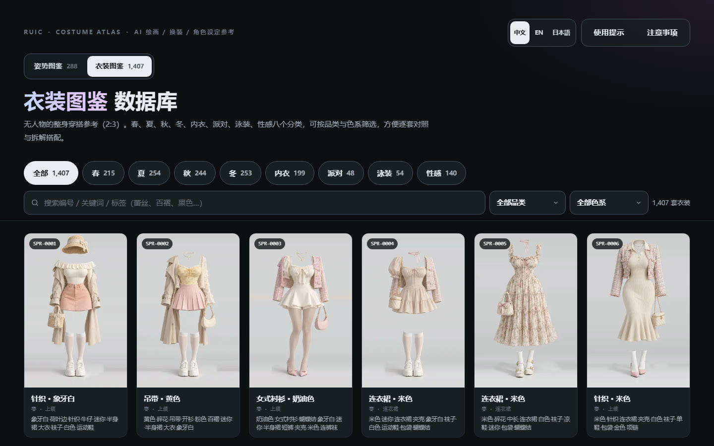
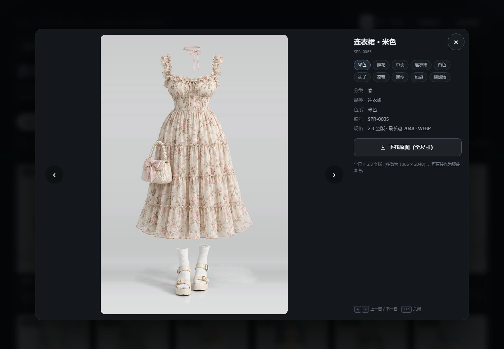
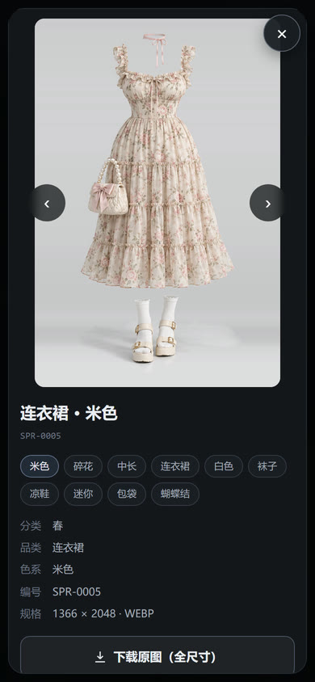
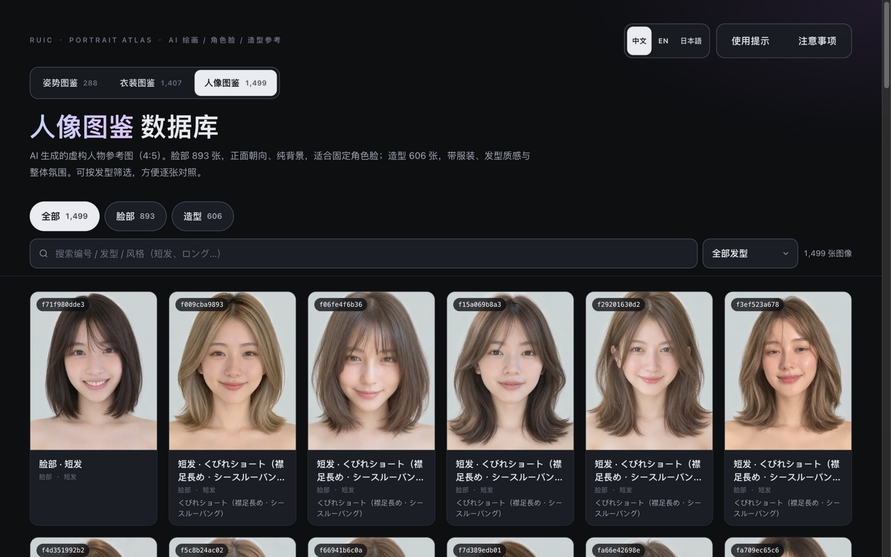
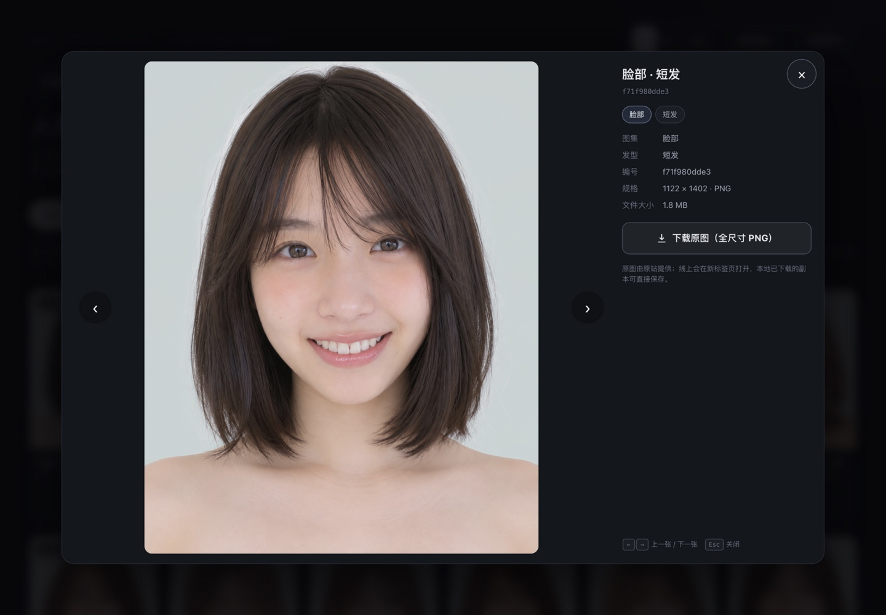
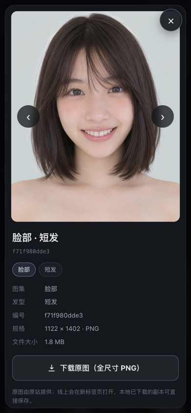

<div align="center">


# RuiC-PoseAtlas

**三图鉴 · 三语参考库**<br>
**288 组人体姿态 / 1,439 张多角度人台线稿　　1,407 套无人衣装 / 8 个分类　　1,499 张 AI 人像 / 893 脸部 + 606 造型**

中文 · English · 日本語

<p>
  <a href="https://hruiccc.github.io/RuiC-PoseAtlas/"><strong>姿势图鉴 →</strong></a> ·
  <a href="https://hruiccc.github.io/RuiC-PoseAtlas/costume.html"><strong>衣装图鉴 →</strong></a> ·
  <a href="https://hruiccc.github.io/RuiC-PoseAtlas/face.html"><strong>人像图鉴 →</strong></a> ·
  <a href="https://github.com/HRuiCcc/RuiC-PoseAtlas">GitHub 仓库</a> ·
  <a href="https://github.com/HRuiCcc/RuiC-PoseAtlas/issues">问题反馈</a>
</p>

[](https://hruiccc.github.io/RuiC-PoseAtlas/)


[界面预览](#界面预览) ·
[赞赏支持](#赞赏支持) ·
[在线体验](#在线体验) ·
[三个图鉴](#三个图鉴) ·
[项目亮点](#项目亮点) ·
[数据概览](#数据概览) ·
[快速开始](#快速开始) ·
[数据构建](#数据构建) ·
[部署](#部署) ·
[致谢与版权](#致谢与版权)

</div>

> **内容提示**：本项目面向成年创作者，部分内容不适合未成年人。请遵守所在地法律法规与平台规范，未成年人请勿使用。

---

## 项目简介

**RuiC-PoseAtlas** 是一个完全静态、零依赖的三图鉴参考站，把「人体怎么摆」「衣服怎么穿」「脸长什么样」三件事放在同一个站点里：

- **姿势图鉴**：288 组去脸人台姿势，每组提供 **正面、斜侧、侧面、俯视、仰视** 五个视角，共 1,439 张参考图。以「姿态」为单位组织，同一组的五个角度收进一张卡片，打开大图后可以用方向键连续切换，体态、比例、镜头关系一眼可比。
- **衣装图鉴**：1,407 套**没有人体**的整身穿搭，按 春 / 夏 / 秋 / 冬 / 内衣 / 派对 / 泳装 / 性感 八个分类归档，每套都拆成了可检索的单品标签——颜色、材质、版型、鞋包配饰。因为它本来就没有画人，直接套到你已有的角色上即可，不需要抠图。
- **人像图鉴**：1,499 张 AI 生成的虚构人像，分为「脸部」893 张与「造型」606 张，按短发 / 中发 / 中长发 / 长发四种发型筛选。脸部是正面朝向、纯背景的脸部参考，适合固定角色脸；造型带服装、发丝质感与整体氛围，适合扩展角色设定。

三者合起来的用法很直接：**姿势定骨架，衣装定皮相，人像定脸。** 先在姿势图鉴里挑一个机位和体态，再去衣装图鉴里找一套同气质的搭配，最后从人像图鉴里选一张脸作为角色参考，三份参考一起丢进生图工具。

很多参考图库的问题是：图片分散、视角不统一、难以把同一姿态的不同角度放在一起比较，服装更是只有一张成品图、说不清到底穿了什么。这个项目以「姿态」「衣装」和「人像」为单位重新组织了三批数据，并为衣装补上了中英日三语标签，让检索这件事真正可用。

同时，它也是一个可以独立部署的前端作品：**纯 HTML + CSS + ES Modules**，没有框架、没有打包器、没有运行时依赖。克隆下来用一个静态服务器打开即可；需要部署时，直接交给 GitHub Pages、Cloudflare Pages、Netlify 或任意静态托管即可。

## 界面预览

### 姿势图鉴

<p align="center">
  
</p>

<p align="center">
  
  
</p>

### 衣装图鉴

<p align="center">
  
</p>

<p align="center">
  
  
</p>

### 人像图鉴

<p align="center">
  
</p>

<p align="center">
  
  
</p>

---

## 赞赏支持

如果这个项目对你有帮助，欢迎微信扫码赞赏，支持后续的整理与维护。

<p align="center">
  
</p>

<p align="center"><sub>微信扫码赞赏 · 感谢支持</sub></p>

如果暂时不方便赞赏，点一个 **Star ⭐** 或把项目分享给需要姿态 / 衣装参考的朋友，也是很大的支持。

---

## 在线体验

> **姿势图鉴：https://hruiccc.github.io/RuiC-PoseAtlas/**
> **衣装图鉴：https://hruiccc.github.io/RuiC-PoseAtlas/costume.html**
> **人像图鉴：https://hruiccc.github.io/RuiC-PoseAtlas/face.html**

三个页面顶部都有切换器，来回跳转不会丢语言设置；都支持 `?lang=zh|en|ja` 与条目深链接。

### 这个项目适合谁

- **AI 绘画创作者**：姿势定构图，衣装定造型，两份参考可以分开用也可以一起用。
- **3D 建模 / 动画学习者**：快速查看体块关系、比例、四肢走向与机位变化。
- **插画与漫画作者**：寻找动态、透视与多人互动的构图灵感，顺手解决「这身衣服怎么画」。
- **换装 / 角色设定**：无人体的衣装图可以直接贴到已有角色上，省掉一次抠图。
- **摄影与视觉设计**：参考站位、镜头高度、服装搭配与配色。
- **前端学习者**：一个无框架、数据驱动、三语 i18n、三套数据集共用一套设计系统的完整静态项目范例。

---

## 三个图鉴

| | 姿势图鉴 | 衣装图鉴 | 人像图鉴 |
| --- | --- | --- | --- |
| 入口 | `index.html` | `costume.html` | `face.html` |
| 数据源 | `data/poses.json` | `data/costumes.json` | `data/faces.json` |
| 条目 | 288 组姿态 | 1,407 套穿搭 | 1,499 张人像 |
| 画面 | 去脸灰色人台线稿，3:4 | 无人体整身服装，2:3 | AI 虚构人物，4:5 |
| 主筛选 | 系列 → 分类 → 视角 | 季节 → 品类 → 色系 | 脸部 / 造型 → 发型 |
| 检索维度 | 姿态名 / 编号 / 分类 / 视角 | 编号 / 英文关键词 / 中英日标签 | 编号 / 分区 / 发型 / 风格 |
| 大图页 | 五视角切换 + 上一组 / 下一组 | 单品标签清单 + 上一套 / 下一套 | 分区与发型信息 + 上一张 / 下一张 |

三页共享同一套设计 token（`assets/css/app.css`）、同一个语言开关（`localStorage` 键 `ruic-poseatlas-lang`）和同一个图集切换器（`assets/css/collection.css`），视觉与手感一致。

---

## 项目亮点

### 姿势图鉴

- **288 组姿态，1,439 张参考图**
  每组 4–5 个视角，按姿态编号归档，避免同组图片散落。

- **五视角对照**
  正面、斜侧、侧面、俯视、仰视一次看全；卡片底部有角度缩略条，点一下即可预览。

- **两种浏览模式**
  「按姿势」以姿态为单位展示；「单张」展开每一个角度，适合逐张筛选。

### 衣装图鉴

- **1,407 套无人衣装，8 个季节分类**
  春 215 / 夏 254 / 秋 244 / 冬 253 / 内衣 199 / 派对 48 / 泳装 54 / 性感 140。

- **每套都拆成单品标签**
  86 个标签词（颜色、材质、版型、单品、配饰），一套平均 8–10 个，卡片上直接铺开，大图页里再列成标签云。不用点开就知道「这条是黑色百褶中长裙 + 皮靴 + 颈饰」。

- **品类 / 色系双下拉筛选**
  10 个品类（连衣裙 191、半身裙 99、外套 77、上装 732、下装 74、内衣 96、泳装 23、鞋履 5、包袋 3、配饰 107）+ 22 个色系，可与季节分类、搜索叠加。

- **分块渲染**
  首屏只渲染 72 张，滚动到底部自动续上；筛选条件一变就回到第一块，不会一次塞进 1,407 个 ``。

### 人像图鉴

- **1,499 张 AI 虚构人像，两个分区**
  脸部 893 张（正面朝向、纯背景）+ 造型 606 张（带服装、发丝质感与整体氛围），适合把「角色脸」和「造型气质」分开挑选。

- **四种发型筛选**
  短发 727 / 中发 376 / 中长发 260 / 长发 136；选择分区后，发型下拉的数量会跟着当前分区重算，不会出现「筛了脸部却看到造型数量」的错位。

- **脸部细节可检索**
  脸部条目保留原作的 51 种发型细节描述（如「くびれショート（襟足長め・シースルーバング）」），搜索框支持编号、分区名、发型名与细节文本。

- **固定角色脸的用法**
  同一张脸部图反复作为角色参考，生成图像或视频时更容易保持脸一致；需要换装或扩设定时，再去造型分区找同气质的参考。

### 三份通用

- **跨语言搜索**
  中文、English、日本語三套字段同时建立索引。姿势搜名称 / 编号 / 分类 / 系列；衣装搜编号 / 英文关键词 / 任意语言的标签；人像搜编号 / 分区 / 发型 / 风格——「短发」「ショート」「short」都能命中。

- **键盘友好的大图浏览**
  姿势：`←` `→` 切换角度，`↑` `↓` 切换姿态，`Esc` 关闭。
  衣装：`←` `→` 切换上一套 / 下一套，`Esc` 关闭。
  人像：`←` `→` 切换上一张 / 下一张，`Esc` 关闭。
  三者都会在空闲时预加载相邻原图。

- **原图下载**
  姿势提供 900 × 1200 PNG；衣装提供 2:3 竖版全尺寸 WEBP（多数 1366 × 2048）；人像提供原站全尺寸 PNG（多数学 1122 × 1402 / 1597 × 2000）。

- **中 / 英 / 日即时切换**
  切换语言会同步更新标题、提示、分类、标签、结果计数、大图页元信息与页脚；选择写入 `localStorage`，也可通过 `?lang=zh|en|ja` 分享指定语言。

- **深链接**
  姿势：`?lang=ja#pose=full_single_P019&angle=side`
  衣装：`#costume=SXY-0039`
  人像：`#portrait=f71f980dde3`

- **响应式布局**
  桌面多列网格、移动端双列；大图页在窄屏自动堆叠并支持滚动，筛选折叠为「筛选」面板。

- **零依赖、零构建**
  没有 React / Vue / 打包器；打开静态服务器就能运行，部署成本极低。

- **工程化校验**
  自带 `npm run verify`：检查三份数据的数量、三语字段、标签完整性、图片尺寸与类型、文件引用、i18n 键完整性等。

---

## 数据概览

### 姿势图鉴

| 项目 | 数值 |
| --- | --- |
| 姿态组 | **288** |
| 参考图 | **1,439** |
| 原始 PNG | **900 × 1200** |
| 缩略图 | **300 × 400 JPEG** |
| 视角 | **5**（正面 / 斜侧 / 侧面 / 俯视 / 仰视） |
| 内容系列 | **4** |
| 子分类 | **26**（站姿、坐姿、跪姿、俯卧、手臂动作、多人互动等） |

### 衣装图鉴

| 项目 | 数值 |
| --- | --- |
| 衣装套数 | **1,407** |
| 分类 | **8**（春 / 夏 / 秋 / 冬 / 内衣 / 派对 / 泳装 / 性感） |
| 品类 | **10** |
| 色系 | **22** |
| 标签词 | **86**（中 / 英 / 日三语对照） |
| 原图 | **2:3 竖版 WEBP**，多数 1366 × 2048，33 张为 1254–1360 宽的同比例小图 |
| 缩略图 | **360 × 540 WEBP** |

### 人像图鉴

| 项目 | 数值 |
| --- | --- |
| 人像总数 | **1,499** |
| 脸部 | **893**（正面朝向、纯背景） |
| 造型 | **606**（服装、发丝质感与氛围） |
| 发型 | **4**（短发 727 / 中发 376 / 中长发 260 / 长发 136） |
| 发型细节 | **51** 种（脸部条目保留原作日文描述） |
| 原图 | **PNG**，多数为 1122 × 1402 或 1597 × 2000，少量横图 |
| 缩略图 | **400 × 500 WEBP**（横图按原比例） |
| 授权 | **CC0 1.0**（原站；图片文件按原站请求不再分发） |

### 通用

| 项目 | 数值 |
| --- | --- |
| 界面语言 | **中文 / English / 日本語** |
| 前端依赖 | **0** |

姿势图片主体为无面部特征的灰色人台线稿（3:4），适合观察体块、比例、关节与镜头关系；衣装图片为无人体整身服装（2:3），适合直接套用与拆解搭配；人像图片为 AI 生成的虚构人物（4:5），适合固定角色脸与扩展造型。

### 文件体积

| 目录 | 内容 | 约计 |
| --- | --- | --- |
| `thumbs/` | 1,439 张 300 × 400 JPEG | 25 MB |
| `img/` | 1,439 张 900 × 1200 PNG | 654 MB |
| `costume/thumbs/` | 1,407 张 360 × 540 WEBP | 13 MB |
| `costume/img/` | 1,407 张 2:3 竖版 WEBP（全尺寸） | 117 MB |
| `portrait/thumbs/` | 1,499 张 400 × 500 WEBP | 30 MB |
| `portrait/img/` | 1,499 张全尺寸 PNG（**仅本地，不随仓库**） | 4.5 GB |
| `data/` | 三语数据 JSON（三份） | 约 1 MB |
| `assets/` | CSS / JS / favicon | 约 160 KB |

三个图鉴的网格都只加载缩略图；原图仅在大图页和下载时请求。仓库内的图片约 840 MB；人像原图为了不超出 GitHub Pages 的 1 GB 站点限制，改为本地下载 + 原站引用（`npm run fetch-faces`），线上页面用 `full_remote` 加载全尺寸图。

---

## 适用场景

| 场景 | 可以怎么用 |
| --- | --- |
| AI 绘画 | 姿势定构图、衣装定造型、人像定脸，三份参考一起喂给模型 |
| 换装 / 角色设定 | 无人体的衣装图直接贴到角色上，省掉抠图；人像图补上脸与气质 |
| 3D 建模 | 快速对齐比例、体块与机位，辅助 blockout 和镜头设计 |
| 插画 / 漫画 | 查看动态、透视、四肢关系，顺手找一身能画的衣服与一张能用的脸 |
| 摄影 | 参考站位、镜头高度、服装搭配与配色 |
| 前端学习 | 参考一个无框架、三语、三数据集共用一套设计系统的静态站点 |

---

## 交互与快捷键

### 姿势图鉴 · 图库

- 点击卡片主图或标题：打开大图。
- 点击卡片底部的角度缩略图：在卡片内预览该角度；再点主图会直接打开该角度。
- 顶部系列标签：切换内容系列。
- 搜索框：支持中文、英文、日文名称、编号、分类。
- 「筛选」：移动端展开分类、角度与视图模式。
- 「按姿势 / 单张」：在两种浏览模式间切换。

### 姿势图鉴 · 大图页

| 按键 | 功能 |
| --- | --- |
| `←` / `→` | 上一个 / 下一个角度 |
| `↑` / `↓` | 上一个 / 下一个姿态 |
| `Esc` | 关闭大图 |
| `Tab` | 在大图页控件间循环聚焦 |

### 衣装图鉴 · 图库

- 顶部季节标签：全部 / 春 / 夏 / 秋 / 冬 / 内衣 / 派对 / 泳装 / 性感，右侧带数量。
- 搜索框：编号（`SXY-0039`）、英文关键词（`corset`）、中文或日文标签（`蕾丝` / `レース`）都能命中。
- 「品类」「色系」两个下拉：与季节、搜索自由叠加，筛选项数量计入「筛选」角标。
- 滚动到底部自动加载下一批（每批 72 张），也可以点「加载更多」。

### 衣装图鉴 · 大图页

| 按键 | 功能 |
| --- | --- |
| `←` / `→` | 上一套 / 下一套 |
| `Esc` | 关闭大图 |
| `Tab` | 在大图页控件间循环聚焦 |

大图页同时提供：

- 全部单品标签（第一个标签是主品类，高亮显示）；
- 分类、品类、色系、编号与规格；
- 「下载原图（全尺寸）」按钮。

### 人像图鉴 · 图库

- 顶部分区标签：全部 / 脸部 / 造型，右侧带数量。
- 搜索框：编号、分区名、发型名与发型细节都能命中；「短发」「ショート」「short」等价。
- 「发型」下拉：短发 / 中发 / 中长发 / 长发；选择分区后，下拉里的数量跟着当前分区重算。
- 滚动到底部自动加载下一批（每批 72 张），也可以点「加载更多」。

### 人像图鉴 · 大图页

| 按键 | 功能 |
| --- | --- |
| `←` / `→` | 上一张 / 下一张 |
| `Esc` | 关闭大图 |
| `Tab` | 在大图页控件间循环聚焦 |

大图页同时提供：

- 分区、发型与发型细节标签；
- 编号、原图尺寸与文件大小；
- 「下载原图（全尺寸 PNG）」按钮：本地已下载时直接保存，线上回退到原站打开。

---

## 三语支持

三个页面都在右上角提供 **中文 / EN / 日本語** 切换，以下内容会同步更新：

- 页面标题、副标题、使用提示与注意事项；
- 姿势：系列名、分类名、姿态名、角度名；
- 衣装：季节名、品类名、色系名、86 个单品标签；
- 人像：分区名、发型名、发型细节、原图规格与文件大小；
- 搜索占位符、筛选选项、结果计数；
- 大图页元信息、下载按钮与键盘提示；
- 页脚来源说明与版权提示。

语言优先级：

1. URL 参数 `?lang=zh|en|ja`
2. `localStorage` 中记住的选择（三个页面共用）
3. 浏览器语言（`ja` → 日本語，`zh` → 中文，其余 → English）

示例：

```text
http://127.0.0.1:8123/?lang=en
http://127.0.0.1:8123/?lang=ja#pose=full_single_P019&angle=side
http://127.0.0.1:8123/costume.html?lang=ja#costume=SXY-0039
```

---

## 快速开始

### 环境要求

- 任意现代浏览器（Chrome / Edge / Safari / Firefox）
- Python 3（用于启动静态服务器）或任意静态服务器
- Node.js ≥ 18（仅在重新生成数据、运行校验时需要）

### 本地运行

```bash
git clone https://github.com/HRuiCcc/RuiC-PoseAtlas.git
cd RuiC-PoseAtlas
python3 -m http.server 8123 --bind 127.0.0.1
```

然后打开：

```text
http://127.0.0.1:8123/              # 姿势图鉴
http://127.0.0.1:8123/costume.html  # 衣装图鉴
http://127.0.0.1:8123/face.html     # 人像图鉴
```

也可以使用：

```bash
npm start
```

> **注意**：请通过 HTTP 打开，不要直接双击 `index.html`。页面使用 `fetch()` 读取 `data/*.json`，在 `file://` 协议下会被浏览器的同源策略拦截。

---

## 项目结构

```text
RuiC-PoseAtlas/
├── index.html                  # 姿势图鉴入口
├── costume.html                # 衣装图鉴入口
├── face.html                   # 人像图鉴入口
├── assets/
│   ├── css/app.css             # 设计系统与响应式布局（三页共用）
│   ├── css/collection.css      # 图集切换器
│   ├── css/costume.css         # 衣装页专属：2:3 卡片、标签云、分块渲染
│   ├── css/face.css            # 人像页专属：4:5 卡片、自适应比例灯箱
│   ├── js/app.js               # 姿势：数据、筛选、渲染、灯箱、快捷键
│   ├── js/i18n.js              # 姿势：中 / 英 / 日 UI 文案
│   ├── js/costume.js           # 衣装：数据、筛选、渲染、灯箱、分块加载
│   ├── js/costume-i18n.js      # 衣装：中 / 英 / 日 UI 文案
│   ├── js/costume-tags.js      # 86 个标签的三语词典 + 品类 / 色系分组
│   ├── js/face.js              # 人像：分区 / 发型筛选、灯箱、本地图回退
│   ├── js/face-i18n.js         # 人像：中 / 英 / 日 UI 文案
│   └── favicon.svg
├── data/
│   ├── poses.json              # 三语姿态数据（288 组 / 1,439 变体）
│   ├── costumes.json           # 三语衣装数据（1,407 套 / 标签索引）
│   └── faces.json              # 人像数据（1,499 张 / 分区 + 发型 + 原站 URL）
├── img/                        # 1,439 张 900 × 1200 PNG 原图
├── thumbs/                     # 1,439 张 300 × 400 JPEG 缩略图
├── costume/
│   ├── thumbs/                 # 1,407 张 360 × 540 WEBP 缩略图
│   └── img/                    # 1,407 张 2:3 竖版全尺寸 WEBP
├── portrait/
│   ├── thumbs/                 # 1,499 张 400 × 500 WEBP 缩略图（随仓库）
│   └── img/                    # 1,499 张全尺寸 PNG（本地下载，不随仓库）
├── scripts/
│   ├── import-data.mjs         # 合并中日数据并写入英文表 → poses.json
│   ├── import-costumes.mjs     # 归一化衣装快照 + 标签 → costumes.json
│   ├── import-faces.mjs        # 拉取原站 images.js → faces.json
│   ├── fetch-images.mjs        # 从本仓库下载/恢复姿势图资产（可重复运行）
│   ├── fetch-faces.mjs         # 下载/恢复 1,499 张人像原图与缩略图
│   ├── verify.mjs              # 离线完整性校验（三份数据 + 全部图片）
│   ├── en-pose-names.json      # 288 条英文名称
│   ├── cover/og-cover.html     # 社交分享封面的可复现源文件
│   └── source/                 # 原始中日数据记录（构建输入）
├── docs/                       # README 预览图与赞赏码
├── og-cover.jpg                # 社交分享封面
├── _headers                    # Cloudflare Pages 缓存策略
├── robots.txt
├── package.json
├── LICENSE
└── README.md
```

---

## 数据构建

数据层由三个 Node 脚本生成，不需要任何第三方依赖。

```bash
npm run data        # 姿势：合并 scripts/source/*.json + 英文名称表 → data/poses.json
npm run data:costume # 衣装：scripts/source/costume.json + 标签词典 → data/costumes.json
npm run data:face   # 人像：拉取 ai-portrait-gallery 的 images.js → data/faces.json
npm run verify      # 校验数量、翻译、标签、图片尺寸、文件引用与页面 i18n
```

一条姿态记录的结构示例：

```json
{
  "id": "full_single_P019",
  "series": "full_std",
  "category": "站姿",
  "no": "P019",
  "names": {
    "zh": "站立・双臂上举伸展",
    "en": "Standing, arms reaching overhead",
    "ja": "立ち・両腕を頭上に伸ばす"
  },
  "variants": [
    {
      "angle": "front",
      "thumb": "thumbs/full_single_P019_front.jpg",
      "full": "img/full_single_P019_front.png"
    }
  ]
}
```

一条衣装记录的结构示例：

```json
{
  "id": "SXY-0039",
  "cat": "sexy",
  "group": "dress",
  "color": "black",
  "main": "dress",
  "tags": ["black", "dress", "red", "ribbon", "white", "frill", "apron", "stockings", "headband"],
  "thumb": "costume/thumbs/SXY-0039.webp",
  "image": "costume/img/SXY-0039.webp"
}
```

一条人像记录的结构示例：

```json
{
  "id": "f71f980dde3",
  "sec": "face",
  "hair": "short",
  "style": "くびれショート（襟足長め・シースルーバング）",
  "w": 1122,
  "h": 1402,
  "thumb_w": 400,
  "thumb_h": 500,
  "bytes": 1895954,
  "thumb": "portrait/thumbs/f71f980dde3.webp",
  "full": "portrait/img/f71f980dde3.png",
  "thumb_remote": "https://ai-portrait-gallery.pages.dev/img/thumb/f71f980dde3.webp",
  "full_remote": "https://ai-portrait-gallery.pages.dev/img/full/f71f980dde3.png"
}
```

构建脚本会：

- 姿势：以姿态编号聚合同一组的多个角度，合并中日原始名称并写入英文表，验证系列 / 分类 / 角度的一致性；
- 衣装：把原作的分类映射为 8 个键、按优先级归入 10 个品类、取第一个颜色标签作为主色，并按标签词典补齐三语文案；
- 人像：把原站的 `face` / `styling` 映射为两个分区、四种发型与 51 种脸部细节，同时写入本地路径与原站绝对 URL；
- 三者都输出紧凑 JSON，供前端直接加载。

### 添加一组新姿态

1. 把 4–5 张 PNG 放入 `img/`，缩略图放入 `thumbs/`；
2. 在 `scripts/source/` 的记录中补充对应条目；
3. 在 `scripts/en-pose-names.json` 补充英文名称；
4. 运行 `npm run data && npm run verify`。

### 添加一套新衣装

1. 把全尺寸 WEBP 放入 `costume/img/`，缩略图放入 `costume/thumbs/`（360 × 540）；
2. 在 `scripts/source/costume.json` 追加一行（`id` / `カテゴリ` / `キーワード`）；
3. 如果关键词里有词表之外的新标签，先在 `assets/js/costume-tags.js` 的 `TAG_NAMES` 里补三语，必要时加进 `GROUPS` 或 `COLOR_TAGS`；
4. 运行 `npm run data:costume && npm run verify`。

请确保你拥有所提交图片的使用与分发授权。

### 添加一张新人像

1. 把原图与缩略图分别放入 `portrait/img/` 与 `portrait/thumbs/`（缩略图 400 × 500 WEBP，横图按原比例）；
2. 在 `scripts/import-faces.mjs` 的 `SECTIONS` / `HAIRS` 映射里确认分区与发型键；
3. 运行 `npm run data:face` 重新生成 `data/faces.json`；
4. 运行 `npm run verify` 校验文件、尺寸与三语键。

### 图片下载与恢复

仓库内的姿势、衣装与缩略图已完整随仓库提供。若在全新克隆中需要恢复缺失文件，可运行 GitHub Actions 工作流 **Fetch image assets**，或在本地运行：

```bash
npm run fetch-images   # 姿势：从本仓库并发下载缺失的 img/ + thumbs/
npm run fetch-faces    # 人像：从原站下载 1,499 张原图 + 缩略图到 portrait/
```

`fetch-images` 会从 `data/poses.json` 收集全部姿势图片路径，并发下载缺失文件（已存在且签名正确的自动跳过），校验文件签名，失败自动切换源并重试。衣装图片体积较小且使用 WEBP，未纳入该脚本；缺失时按上表路径从原作重新获取即可。

`fetch-faces` 会读取 `data/faces.json`，并发下载 1,499 张缩略图与 1,499 张全尺寸 PNG。**`portrait/img/` 体积约 4.5 GB，已加入 `.gitignore`**：它只存在于本地，用于离线浏览与直接保存原图；线上页面在非 localhost 环境自动使用 `full_remote`，从原站加载全尺寸图。

> 部分克隆（`git sparse-checkout` 只取代码）下没有 `img/` 与 `thumbs/`，可用 `SKIP_POSE_IMAGES=1 npm run verify` 跳过姿势图检查，衣装图与数据仍会完整校验。

---

## 部署

### GitHub Pages（当前在线演示）

仓库已内置 `.github/workflows/deploy-pages.yml`：

- push 到 `main` 且涉及站点文件时自动部署；
- 也可以在 Actions 页面手动运行 `Deploy to GitHub Pages`；
- 部署时只打包运行所需的 `index.html`、`costume.html`、`face.html`、`assets/`、`data/`、`img/`、`thumbs/`、`costume/`、`portrait/thumbs/`、`og-cover.jpg`、`robots.txt`，不会公开 README、`scripts/`、`docs/` 中的赞赏码等仓库文件，也不会打包本地 4.5 GB 的 `portrait/img/`。

当前地址：

- 姿势图鉴：**https://hruiccc.github.io/RuiC-PoseAtlas/**
- 衣装图鉴：**https://hruiccc.github.io/RuiC-PoseAtlas/costume.html**
- 人像图鉴：**https://hruiccc.github.io/RuiC-PoseAtlas/face.html**

### Cloudflare Pages（备选）

1. 连接本仓库；
2. Framework preset 选择 **None**；
3. Build command 留空；
4. Output directory 填 `/`；
5. 部署完成后即可访问。

`_headers` 已配置：

- `/img/*`、`/thumbs/*`、`/costume/thumbs/*`、`/costume/img/*`、`/portrait/thumbs/*`：一年强缓存；
- `/data/*`：5 分钟缓存；
- `/index.html`、`/costume.html`：每次校验。

> Cloudflare Pages 的限制是单文件 25 MiB、每次部署 20,000 个文件。本项目共约 7,191 张图片，远低于文件数限制，单张图片也远低于 25 MiB。

### 其他静态托管

本项目没有构建步骤，以下方式都可以：

- Netlify / Vercel：输出目录设为仓库根目录；
- 任意对象存储 / Nginx：把整个目录作为静态站点根目录。

> 如果使用 GitHub Pages 的「Deploy from a branch」模式，请把发布目录限制为站点文件，避免把 README、`scripts/`、`docs/` 暴露为静态资源；本仓库默认使用 Actions 打包模式。

如果使用自定义域名，建议同步修改两个 HTML 中的 `og:image` 为绝对 URL，便于社交平台抓取封面。

---

## 质量校验

`npm run verify` 会检查：

- 288 组姿态、1,439 张图片、1,407 套衣装、1,499 张人像的数量是否与索引一致；
- 每组姿态是否有中 / 英 / 日三套名称，系列 / 分类 / 角度是否翻译完整；
- 每套衣装是否有分类、品类、色系，标签是否全部在词典中，主标签是否在标签列表里；
- 每张人像是否有合法分区 / 发型键、尺寸、原站 URL 与本地路径；
- 四个分类计数、十个品类计数、两个分区与四种发型计数是否与条数吻合；
- 每个文件引用是否存在、是否重复；
- 每张姿势原图是否为 900 × 1200 PNG、缩略图是否为 300 × 400 JPEG；
- 每张衣装原图是否为 2:3 竖版 WEBP、缩略图是否为 360 × 540；
- 本地 `portrait/` 存在时，1,499 张原图与缩略图是否齐全，抽样尺寸是否与数据一致；
- 三个 HTML 中使用的 i18n 键是否都存在，三语字典键是否一一对应；
- 站点 UI 是否误加了赞赏码 / 支持区块；
- README 预览图与 OG 封面是否存在。

这保证项目在新增内容或修改文案后，不会悄悄出现缺图、缺翻译或断链。

---

## 设计与实现说明

- **三数据集、单设计系统**：三个页面各自一套控制器，但共用 `app.css` 的设计 token、语言开关与筛选控件样式，所以看起来是一个站，而不是三个拼起来的页面。
- **数据驱动**：`data/poses.json`、`data/costumes.json` 与 `data/faces.json` 是唯一数据源；筛选、搜索、卡片、灯箱都从同一份数据派生。
- **标签即索引**：衣装的 86 个标签同时承担展示、筛选与搜索三个职责——显示时本地化，筛选时按 `GROUPS` / `COLOR_TAGS` 归桶，搜索时把中英日三种写法一起塞进 `_search` 字符串。
- **零框架**：原生 ES Modules + 事件委托 + `innerHTML` 模板，减少运行时与构建复杂度。
- **图片策略**：网格加载缩略图；打开大图时才请求原图；相邻条目会在空闲时预加载。衣装页与人像页额外做了分块渲染（72 张一批 + 滚动自动续加载）。人像原图在本地优先读 `portrait/img/`，部署环境自动回退到原站 URL。
- **渲染性能**：搜索输入做 120ms 防抖；卡片图片使用 `loading="lazy"` 与 `decoding="async"`。
- **可访问性**：跳转链接、`aria-live` 结果计数、`aria-pressed` 状态、焦点陷阱、`Esc` 关闭、关闭后焦点归还、`prefers-reduced-motion` 支持。
- **视觉方向**：深色底、冷色渐变、纸质画布、低对比卡片边框；强调图片本身而不是装饰。
- **i18n 结构**：UI 文案分放在 `assets/js/i18n.js`、`assets/js/costume-i18n.js` 与 `assets/js/face-i18n.js`；内容名称随数据一起提供三语字段；标签词典独立在 `assets/js/costume-tags.js`。
- **可部署性**：所有资源使用相对路径，可直接放在任意子目录或静态托管根目录。

---

## 常见问题

### 为什么仓库这么大？

图片已完整随仓库提供：1,439 张 900 × 1200 PNG 共约 654 MB、25 MB 缩略图，加上 1,407 套衣装的 13 MB 缩略图与 117 MB 全尺寸 WEBP，以及 1,499 张人像的 30 MB 缩略图。网页不会加载原图，只会在打开大图或下载时请求。克隆仓库需要一次性下载全部图片。

人像的 4.5 GB 全尺寸 PNG 没有进仓库：GitHub Pages 的站点体积上限是 1 GB，现有姿势 + 衣装 + 缩略图已约 840 MB，再放原图会让部署失败。需要离线原图时运行 `npm run fetch-faces`，本地会下载到 `portrait/img/`；线上页面从原站加载全尺寸图。

### 为什么打开 `index.html` 是空白？

页面通过 `fetch()` 读取 `data/*.json`，`file://` 协议下会被 CORS 拦截。请用任意静态服务器打开，例如 `python3 -m http.server`。

### 三个图鉴是同一份数据吗？

不是。姿势、衣装与人像来自原作者的三个独立项目（POSE-DB-01 / COSTUME-DB-01 / AIモデル顔データベース），数据模型也不同：姿态按「一组多视角」组织，衣装按「一套多标签」组织，人像按「分区 + 发型 + 单张」组织，所以各自有独立的数据文件与控制器。

### 为什么衣装用 WEBP 而不是 PNG？

原作「元サイズ」提供的 PNG 与 WEBP 像素尺寸完全一致（多数 1366 × 2048），WEBP 体积约为 PNG 的 1/12。全量存 PNG 会让仓库从 810 MB 涨到 2.2 GB 以上，因此这里统一存 WEBP，画质与分辨率不打折。人像原图没有转换格式，保留原站 PNG；只是不随仓库分发。

### 可以商用吗？

图片与原始数据的版权归原作者所有。姿势与衣装原作者允许将作品用于创作（包括商用、编辑与参考），但**禁止再分发、转载、转售图片数据本身**。人像原站以 CC0 1.0 发布，可商用、可编辑，但同样请求不要转载图片文件。如果你要商用，请先阅读原站说明并自行确认合规性。

### 可以只部署缩略图吗？

可以。网格浏览只需要 `thumbs/`、`costume/thumbs/` 与 `portrait/thumbs/`；人像页的大图会回退到 `full_remote` 的原站地址。姿势与衣装如果移除 `full` / `image` 字段，则大图页和下载功能会不可用。

### 如何新增语言？

1. 在 `assets/js/i18n.js`、`assets/js/costume-i18n.js` 与 `assets/js/face-i18n.js` 中增加语言字典；
2. 在 `data/poses.json` 的 `names`、`data/costumes.json` 的分类名、`data/faces.json` 的分区 / 发型名，以及 `costume-tags.js` 的 `TAG_NAMES` 中增加对应字段；
3. 在三个语言切换器中加入按钮；
4. 运行 `npm run verify` 检查键是否完整。

### 为什么不用 React / Vue？

这个项目的交互复杂度并不需要框架：数据量固定、视图是列表与灯箱、没有服务端状态。纯原生实现让部署更简单，也更容易长期维护。

### 支持手机吗？

支持。移动端使用双列卡片、折叠筛选面板和可滚动的大图页；已在 390 × 844 视口验证三个页面均无横向溢出。

---

## 致谢与版权

### 图片与原始数据

- **姿势原作**：[POSE-DB-01](https://ai-pose-gallery.pages.dev/)
- **衣装原作**：[COSTUME-DB-01](https://ai-costume-gallery.pages.dev/)
- **人像原作**：[AIモデル顔データベース](https://ai-portrait-gallery.pages.dev/)
- **原作者**：[ギア (@giaaibusi)](https://x.com/giaaibusi)（姿势 / 衣装）、[あぎ (@agi_aibusi)](https://x.com/agi_aibusi)（人像）

图片、原始日文名称与分类数据来自原作者公开的三个项目；本项目仅做数据整理、英文名称补全、标签三语对照与前端重写。

### 前端

本项目的 HTML / CSS / JavaScript / i18n / 校验脚本均为从零编写，未复用原作的前端代码。数据 schema、筛选逻辑、灯箱交互、三语字典和视觉样式均为本项目自有实现。

### 免责声明

- 本项目为非官方整理，与原作者无隶属关系。
- 姿势画面为无面部特征的人台线稿，衣装画面为无人体服装图，人像画面为 AI 生成的虚构人物，均非真实人物或商品。
- 请勿将本项目用于违法、侵权或违反公序良俗的用途；人像尤其不得用于冒充真实人物。
- 如图片版权方认为本仓库的收录方式不妥，请通过 Issue 联系，会第一时间处理。

---

## License

- **源代码 / 样式 / 脚本 / 文档**：MIT License，详见 [LICENSE](LICENSE)。
- **图片、原始数据与名称**：不在 MIT 许可范围内，版权归原作者所有；禁止转售或再分发图片数据本身。人像图片按原站 CC0 1.0 发布，但原站请求不要转载图片文件。

> 使用本项目即表示你已阅读并同意上述说明。请尊重原作者的劳动成果。
