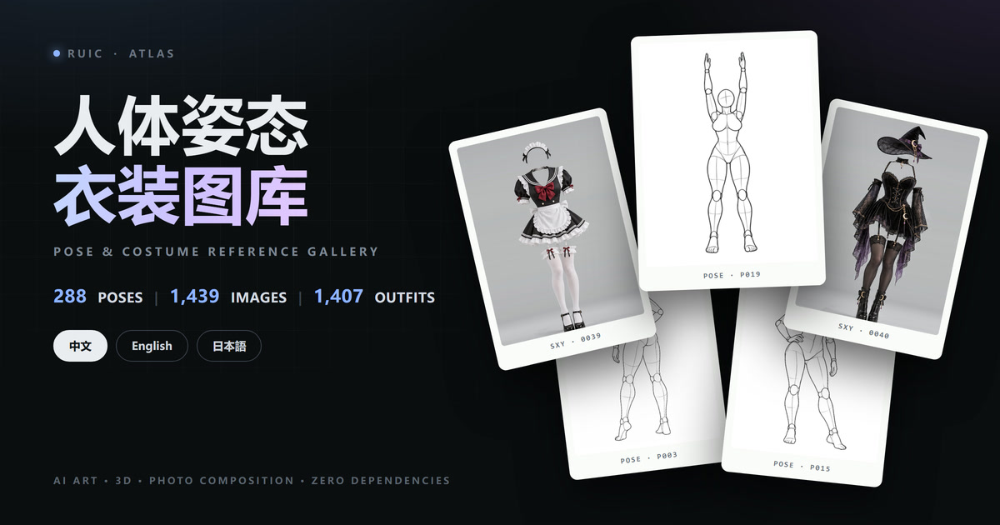
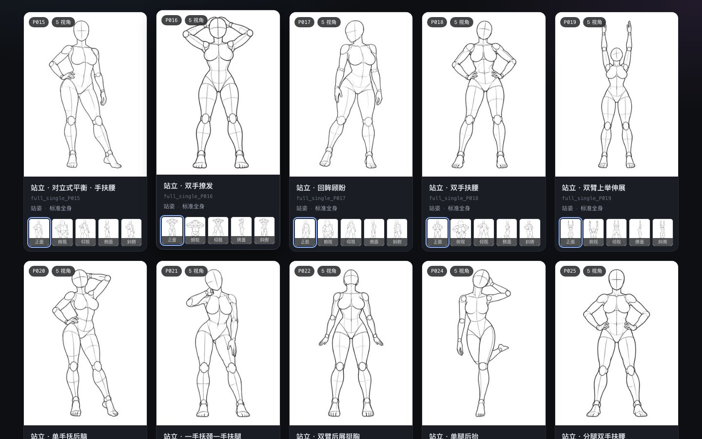
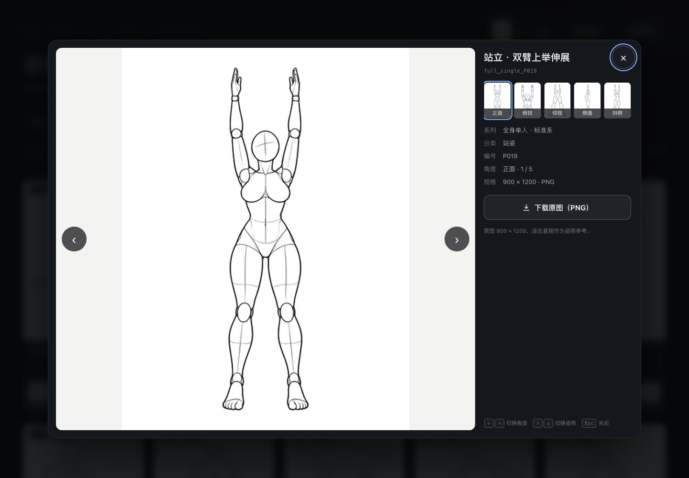
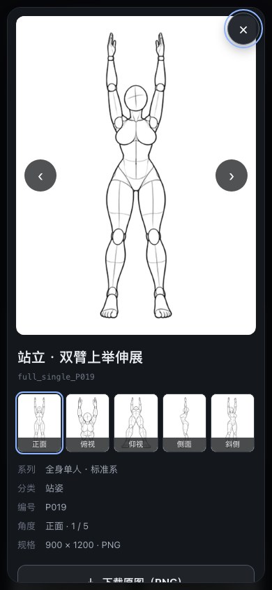

<div align="center">



# RuiC-PoseAtlas

**三语人体姿态参考图库 · 288 组姿态 / 1,439 张多角度人台线稿**

中文 · English · 日本語

<p>
  <a href="https://hruiccc.github.io/RuiC-PoseAtlas/"><strong>在线体验 →</strong></a> ·
  <a href="https://github.com/HRuiCcc/RuiC-PoseAtlas">GitHub 仓库</a> ·
  <a href="https://github.com/HRuiCcc/RuiC-PoseAtlas/issues">问题反馈</a>
</p>

[](https://hruiccc.github.io/RuiC-PoseAtlas/)


[在线体验](#在线体验) ·
[项目简介](#项目简介) ·
[界面预览](#界面预览) ·
[数据概览](#数据概览) ·
[快速开始](#快速开始) ·
[数据构建](#数据构建) ·
[部署](#部署) ·
[致谢与版权](#致谢与版权) ·
[赞赏支持](#赞赏支持)

</div>

> **内容提示**：本项目面向成年创作者，部分内容不适合未成年人。请遵守所在地法律法规与平台规范，未成年人请勿使用。

> **原作者项目**：[POSE-DB-01](https://ai-pose-gallery.pages.dev/) · **作者**：[ギア (@giaaibusi)](https://x.com/giaaibusi)

---

## 项目简介

**RuiC-PoseAtlas** 是一个完全静态、零依赖的多角度人体姿态参考图库。它把 288 组姿态整理成可检索的卡片，每组提供 **正面、斜侧、侧面、俯视、仰视** 五个视角；配合大图浏览、键盘切换与 PNG 原图下载，方便在 AI 绘画、3D 建模、插画与摄影构图之间快速对照。

很多参考图库的问题是：图片分散、视角不统一、难以把同一姿态的不同角度放在一起比较。这个项目以「姿态」为单位组织数据，把同一组的五个视角收进一张卡片；打开大图后可以用方向键连续切换，保持体态、比例和镜头关系的一致性。

同时，它也是一个可以独立部署的前端作品：**纯 HTML + CSS + ES Modules**，没有框架、没有打包器、没有运行时依赖。克隆下来用一个静态服务器打开即可；需要部署时，直接交给 GitHub Pages、Cloudflare Pages、Netlify 或任意静态托管即可。

## 在线体验

> **https://hruiccc.github.io/RuiC-PoseAtlas/**

由 GitHub Pages 自动部署，直接打开即可浏览；支持 `?lang=zh|en|ja` 与姿态深链接。页面中的图片、缩略图、数据与本地版本一致。

### 这个项目适合谁

- **AI 绘画创作者**：作为姿态、构图、镜头高度的参考，与角色、服装、场景参考配合使用。
- **3D 建模 / 动画学习者**：快速查看体块关系、比例、四肢走向与机位变化。
- **插画与漫画作者**：寻找动态、透视与多人互动的构图灵感。
- **摄影与视觉设计**：参考站位、镜头高度、人物与画面的关系。
- **前端学习者**：一个无框架、数据驱动、三语 i18n 的完整静态项目范例。

---

## 界面预览

> 以下截图使用「标准全身」系列与站立姿态，便于展示界面结构。

<p align="center">
  
</p>

<p align="center">
  
  
</p>

---

## 项目亮点

- **288 组姿态，1,439 张参考图**  
  每组 4–5 个视角，按姿态编号归档，避免同组图片散落。

- **五视角对照**  
  正面、斜侧、侧面、俯视、仰视一次看全；卡片底部有角度缩略条，点一下即可预览。

- **两种浏览模式**  
  「按姿势」以姿态为单位展示；「单张」展开每一个角度，适合逐张筛选。

- **跨语言搜索**  
  中文、English、日本語三套名称同时建立索引；搜姿态名、编号、分类、系列都能命中。

- **系列 / 分类 / 角度筛选**  
  四个内容系列、26 个子分类、五个视角，可自由组合；移动端折叠为「筛选」面板。

- **键盘友好的大图浏览**  
  `←` `→` 切换角度，`↑` `↓` 切换姿态，`Esc` 关闭；自动预加载相邻原图。

- **原图下载**  
  大图页提供 900 × 1200 PNG 原图下载，适合直接作为创作参考。

- **中 / 英 / 日即时切换**  
  右上角切换语言；选择会写入 `localStorage`，也可通过 `?lang=zh|en|ja` 分享指定语言。

- **深链接**  
  例如 `?lang=ja#pose=full_single_P019&angle=side`，可直接分享某一姿态的某个角度。

- **响应式布局**  
  桌面多列网格、移动端双列；大图页在窄屏自动堆叠并支持滚动。

- **零依赖、零构建**  
  没有 React / Vue / 打包器；打开静态服务器就能运行，部署成本极低。

- **工程化校验**  
  自带 `npm run verify`：检查数据数量、三语名称、图片尺寸、文件引用、i18n 键完整性等。

---

## 数据概览

| 项目 | 数值 |
| --- | --- |
| 姿态组 | **288** |
| 参考图 | **1,439** |
| 原始 PNG | **900 × 1200** |
| 缩略图 | **300 × 400 JPEG** |
| 视角 | **5**（正面 / 斜侧 / 侧面 / 俯视 / 仰视） |
| 内容系列 | **4** |
| 子分类 | **26**（站姿、坐姿、跪姿、俯卧、手臂动作、多人互动等） |
| 界面语言 | **中文 / English / 日本語** |
| 前端依赖 | **0** |

图片主体为无面部特征的灰色人台线稿（3:4），适合观察体块、比例、关节与镜头关系。面部、服装、背景可以在自己的创作流程中另行补全。

### 文件体积

| 目录 | 内容 | 约计 |
| --- | --- | --- |
| `thumbs/` | 1,439 张 300 × 400 JPEG | 25 MB |
| `img/` | 1,439 张 900 × 1200 PNG | 654 MB |
| `data/` | 三语数据 JSON | 186 KB |
| `assets/` | CSS / JS / favicon | 约 60 KB |

网格只加载缩略图；原图仅在大图页和下载时请求。克隆仓库需要下载完整图片，首次拉取会稍慢。

---

## 适用场景

| 场景 | 可以怎么用 |
| --- | --- |
| AI 绘画 | 作为姿态 / 构图 / 镜头参考，配合角色、服装、场景参考一起使用 |
| 3D 建模 | 快速对齐比例、体块与机位，辅助 blockout 和镜头设计 |
| 插画 / 漫画 | 查看动态、透视、四肢关系，寻找同一姿态的不同角度 |
| 摄影 | 参考站位、镜头高度与画面构图 |
| 前端学习 | 参考一个无框架、三语、数据驱动的静态图库实现 |

---

## 交互与快捷键

### 图库

- 点击卡片主图或标题：打开大图。
- 点击卡片底部的角度缩略图：在卡片内预览该角度；再点主图会直接打开该角度。
- 顶部系列标签：切换内容系列。
- 搜索框：支持中文、英文、日文名称、编号、分类。
- 「筛选」：移动端展开分类、角度与视图模式。
- 「按姿势 / 单张」：在两种浏览模式间切换。

### 大图页

| 按键 | 功能 |
| --- | --- |
| `←` / `→` | 上一个 / 下一个角度 |
| `↑` / `↓` | 上一个 / 下一个姿态 |
| `Esc` | 关闭大图 |
| `Tab` | 在大图页控件间循环聚焦 |

大图页同时提供：

- 五个角度的缩略图切换；
- 姿态名称、系列、分类、编号、角度与规格；
- 「下载原图（PNG）」按钮；
- 当前角度与总角度进度。

---

## 三语支持

界面右上角提供 **中文 / EN / 日本語** 切换，以下内容会同步更新：

- 页面标题、副标题、使用提示与注意事项；
- 系列名、分类名、姿态名、角度名；
- 搜索占位符、筛选选项、结果计数；
- 大图页元信息、下载按钮与键盘提示；
- 页脚来源说明与版权提示。

语言优先级：

1. URL 参数 `?lang=zh|en|ja`
2. `localStorage` 中记住的选择
3. 浏览器语言（`ja` → 日本語，`zh` → 中文，其余 → English）

示例：

```text
http://127.0.0.1:8123/?lang=en
http://127.0.0.1:8123/?lang=ja#pose=full_single_P019&angle=side
```

---

## 快速开始

### 环境要求

- 任意现代浏览器（Chrome / Edge / Safari / Firefox）
- Python 3（用于启动静态服务器）或任意静态服务器
- Node.js ≥ 18（仅在重新生成数据、运行校验时需要）

### 本地运行

```bash
git clone https://github.com/HRuiCcc/RuiC-PoseAtlas.git
cd RuiC-PoseAtlas
python3 -m http.server 8123 --bind 127.0.0.1
```

然后打开：

```text
http://127.0.0.1:8123/
```

也可以使用：

```bash
npm start
```

> **注意**：请通过 HTTP 打开，不要直接双击 `index.html`。页面使用 `fetch()` 读取 `data/poses.json`，在 `file://` 协议下会被浏览器的同源策略拦截。

---

## 项目结构

```text
RuiC-PoseAtlas/
├── index.html                  # 单页入口
├── assets/
│   ├── css/app.css             # 设计系统与响应式布局
│   ├── js/app.js               # 数据、筛选、渲染、灯箱、快捷键
│   ├── js/i18n.js              # 中 / 英 / 日 UI 文案
│   └── favicon.svg
├── data/
│   └── poses.json              # 三语姿态数据（288 组 / 1,439 变体）
├── img/                        # 1,439 张 900 × 1200 PNG 原图
├── thumbs/                     # 1,439 张 300 × 400 JPEG 缩略图
├── scripts/
│   ├── import-data.mjs         # 合并中日数据并写入英文表
│   ├── fetch-images.mjs        # 从本仓库下载/恢复图片资产（可重复运行）
│   ├── verify.mjs              # 离线完整性校验
│   ├── en-pose-names.json      # 288 条英文名称
│   └── source/                 # 原始中日数据记录（构建输入）
├── .github/workflows/
│   ├── fetch-images.yml        # 云端下载并提交图片资产
│   └── deploy-pages.yml        # 自动部署 GitHub Pages
├── docs/                       # README 预览图与赞赏码
├── og-cover.jpg                # 社交分享封面
├── _headers                    # Cloudflare Pages 缓存策略
├── robots.txt
├── package.json
├── LICENSE
└── README.md
```

---

## 数据构建

数据层由一个 Node 脚本生成，不需要任何第三方依赖。

```bash
npm run data      # 合并 scripts/source/*.json + 英文名称表 → data/poses.json
npm run verify    # 校验数量、翻译、图片尺寸、文件引用与页面 i18n
```

一条姿态记录的结构示例：

```json
{
  "id": "full_single_P019",
  "series": "full_std",
  "category": "站姿",
  "no": "P019",
  "names": {
    "zh": "站立・双臂上举伸展",
    "en": "Standing, arms reaching overhead",
    "ja": "立ち・両腕を頭上に伸ばす"
  },
  "variants": [
    {
      "angle": "front",
      "thumb": "thumbs/full_single_P019_front.jpg",
      "full": "img/full_single_P019_front.png"
    }
  ]
}
```

构建脚本会：

- 以姿态编号聚合同一组的多个角度；
- 合并中文、日文原始名称，并写入英文名称表；
- 验证系列、分类、角度的一致性；
- 输出紧凑的 `data/poses.json`，供前端直接加载。

### 添加一组新姿态

1. 把 4–5 张 PNG 放入 `img/`，缩略图放入 `thumbs/`；
2. 在 `scripts/source/` 的记录中补充对应条目；
3. 在 `scripts/en-pose-names.json` 补充英文名称；
4. 运行 `npm run data && npm run verify`。

请确保你拥有所提交图片的使用与分发授权。

### 图片下载与恢复

仓库内的 2,878 张图片（1,439 PNG + 1,439 JPEG）体积较大，已完整随仓库提供。若在全新克隆中需要恢复缺失文件，可运行 GitHub Actions 工作流 **Fetch image assets**，或在本地运行：

```bash
npm run fetch-images
```

该脚本会：

- 从 `data/poses.json` 收集全部图片路径；
- 并发下载缺失文件，已存在且签名正确的文件自动跳过；
- 校验 PNG / JPEG 文件签名；
- 下载失败自动切换源并重试。

工作流下载完成后会执行 `npm run verify`，再提交图片变更。

---

## 部署

### GitHub Pages（当前在线演示）

仓库已内置 `.github/workflows/deploy-pages.yml`：

- push 到 `main` 且涉及站点文件时自动部署；
- 也可以在 Actions 页面手动运行 `Deploy to GitHub Pages`；
- 部署时只打包运行所需的 `index.html`、`assets/`、`data/`、`img/`、`thumbs/`、`og-cover.jpg`、`robots.txt`，不会公开 README、`scripts/`、`docs/` 中的赞赏码等仓库文件。

当前地址：**https://hruiccc.github.io/RuiC-PoseAtlas/**

### Cloudflare Pages（备选）

1. 连接本仓库；
2. Framework preset 选择 **None**；
3. Build command 留空；
4. Output directory 填 `/`；
5. 部署完成后即可访问。

`_headers` 已配置：

- `/img/*`、`/thumbs/*`：一年强缓存；
- `/data/*`：5 分钟缓存；
- `/index.html`：每次校验。

> Cloudflare Pages 的限制是单文件 25 MiB、每次部署 20,000 个文件。本项目有 2,880 张图片，远低于文件数限制，单张图片也远低于 25 MiB。

### 其他静态托管

本项目没有构建步骤，以下方式都可以：

- Netlify / Vercel：输出目录设为仓库根目录；
- 任意对象存储 / Nginx：把整个目录作为静态站点根目录。

> 如果使用 GitHub Pages 的「Deploy from a branch」模式，请把发布目录限制为站点文件，避免把 README、`scripts/`、`docs/` 暴露为静态资源；本仓库默认使用 Actions 打包模式。

如果使用自定义域名，建议同步修改 `index.html` 中的 `og:image` 为绝对 URL，便于社交平台抓取封面。

---

## 质量校验

`npm run verify` 会检查：

- 288 组姿态、1,439 张图片的数量是否与索引一致；
- 每组姿态是否有中 / 英 / 日三套名称；
- 系列、分类、角度是否有完整三语翻译；
- 每条图片引用是否存在、是否重复；
- 每张原图是否为 900 × 1200 PNG；
- 每张缩略图是否为 300 × 400 JPEG；
- `index.html` 中使用的 i18n 键是否都存在；
- 三种语言字典的键是否一一对应；
- 站点 UI 是否误加了赞赏码 / 支持区块；
- README 预览图与 OG 封面是否存在。

这保证项目在新增内容或修改文案后，不会悄悄出现缺图、缺翻译或断链。

---

## 设计与实现说明

- **数据驱动**：`data/poses.json` 是唯一数据源；筛选、搜索、卡片、灯箱都从同一份数据派生。
- **零框架**：原生 ES Modules + 事件委托 + `innerHTML` 模板，减少运行时与构建复杂度。
- **图片策略**：网格加载 300 × 400 缩略图；打开大图时才请求 PNG；相邻角度与相邻姿态会在空闲时预加载。
- **渲染性能**：搜索输入做 120ms 防抖；卡片图片使用 `loading="lazy"` 与 `decoding="async"`。
- **可访问性**：跳转链接、`aria-live` 结果计数、`aria-pressed` 状态、焦点陷阱、`Esc` 关闭、关闭后焦点归还、`prefers-reduced-motion` 支持。
- **视觉方向**：深色底、冷色渐变、纸质画布、低对比卡片边框；强调图片本身而不是装饰。
- **i18n 结构**：UI 文案集中在 `assets/js/i18n.js`；内容名称随数据一起提供三语字段。
- **可部署性**：所有资源使用相对路径，可直接放在任意子目录或静态托管根目录。

---

## 常见问题

### 为什么仓库这么大？

图片已完整随仓库提供：1,439 张 900 × 1200 PNG 共约 654 MB，另有 25 MB 缩略图。网页网格不会加载原图，只会在打开大图或下载时请求。克隆仓库需要一次性下载全部图片。

### 为什么打开 `index.html` 是空白？

页面通过 `fetch()` 读取 `data/poses.json`，`file://` 协议下会被 CORS 拦截。请用任意静态服务器打开，例如 `python3 -m http.server`。

### 可以商用吗？

图片与原始数据的版权归原作者所有。原作者允许将作品用于创作（包括商用、编辑与参考），但**禁止再分发、转载、转售图片数据本身**。如果你要商用，请先阅读原始站点的说明，并自行确认合规性。

### 可以只部署缩略图吗？

可以。网格浏览只需要 `thumbs/`；如果不需要原图下载，可以从数据中移除 `full` 字段或调整下载按钮逻辑。但大图页和下载功能会不可用。

### 如何新增语言？

1. 在 `assets/js/i18n.js` 中增加语言字典；
2. 在 `data/poses.json` 的 `names` 中增加对应字段；
3. 在语言切换器中加入按钮；
4. 运行 `npm run verify` 检查键是否完整。

### 为什么不用 React / Vue？

这个项目的交互复杂度并不需要框架：数据量固定、视图是单一列表与灯箱、没有服务端状态。纯原生实现让部署更简单，也更容易长期维护。

### 在线演示在哪里？

**https://hruiccc.github.io/RuiC-PoseAtlas/**。由 GitHub Pages 部署，涉及站点文件的 push 会自动更新。

### 支持手机吗？

支持。移动端使用双列卡片、折叠筛选面板和可滚动的大图页；已在 390 × 844 视口验证无横向溢出。

---

## 致谢与版权

### 图片与原始数据

- **原作 / 原始站点**：[POSE-DB-01](https://ai-pose-gallery.pages.dev/)
- **原作者**：[ギア (@giaaibusi)](https://x.com/giaaibusi)

图片、原始日文名称与分类数据来自原作者公开的项目；本项目仅做数据整理、英文名称补全与前端重写。

### 前端

本项目的 HTML / CSS / JavaScript / i18n / 校验脚本均为从零编写，未复用原作的前端代码。数据 schema、筛选逻辑、灯箱交互、三语字典和视觉样式均为本项目自有实现。

### 免责声明

- 本项目为非官方整理，与原作者无隶属关系。
- 画面为无面部特征的人台线稿，并非真实人物。
- 请勿将本项目用于违法、侵权或违反公序良俗的用途。
- 如图片版权方认为本仓库的收录方式不妥，请通过 Issue 联系，会第一时间处理。

---

## 赞赏支持

如果这个项目对你有帮助，欢迎微信扫码赞赏，支持后续的整理与维护。

<p align="center">
  
</p>

<p align="center"><sub>微信扫码赞赏 · 感谢支持</sub></p>

如果暂时不方便赞赏，点一个 **Star ⭐** 或把项目分享给需要姿态参考的朋友，也是很大的支持。

---

## License

- **源代码 / 样式 / 脚本 / 文档**：MIT License，详见 [LICENSE](LICENSE)。
- **图片、原始数据与名称**：不在 MIT 许可范围内，版权归原作者所有；禁止转售或再分发图片数据本身。

> 使用本项目即表示你已阅读并同意上述说明。请尊重原作者的劳动成果。
